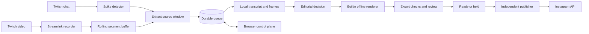

# Architecture and boundaries

Reel Relay separates network-facing capture and publication from offline media work and editorial model calls. FastAPI serves the control plane. The supervisor runs capture, editing, publication and the web server as separate services.

## State and ownership

Each candidate retains source identity, source window, evidence, decision, export hash, review and publication state. New artifact paths are stored relative to the configured data root. Hashes and overlapping-window checks limit duplicate imports and captures.

A worker atomically claims a waiting candidate, changes it to a working state and receives a renewable lease. Completion requires the expected state, lease and claim token. Expired editing claims return to their prior waiting state; publication uncertainty is not recovered by silently repeating a send.

Transient failures have bounded retries. Invalid plans and exhausted retries stop the job. Model-call budgets and revision limits are enforced independently of posting pace. A held or failed clip retains its artifacts for inspection; manual reassessment and revision actions use explicit state/version checks.

SQLite is the default on one machine. PostgreSQL provides transactional claims for concurrent workers. A shared database does not distribute files, synchronize settings or make arbitrary historical projects portable. See [Deployment](DEPLOYMENT.md).

## Capture and intake

Streamlink runs with user configuration and plugin sideloading disabled. Its bytes feed an offline FFmpeg segmenter. Old rolling segments are pruned; extracted candidate originals are separate retained files. Clock discontinuities and reconnects reset timing.

The detector uses a per-channel baseline, distinct-viewer thresholds, per-user caps, deduplication, bot filtering and cooldowns. Chat uses arrival time; video timing is anchored to sealed segments. A configurable offset and pre/post context window compensate for variable latency. They do not establish frame-exact causal alignment.

Only active editing stages consume processing-backlog capacity. Held, rejected, failed and finished clips, including exports waiting to publish, do not. Pending capture windows have a separate bound, and a disk-reserve guard applies independently. When a limit blocks a new trigger, the event is recorded; it is not a promise to replay every missed trigger later. New eligible triggers are accepted once capacity returns.

The app can pause capture or editing without deleting the queue. A current media/model operation may need to finish or stop safely before the observed service state changes.

## Editorial evidence and rendering

Editorial inputs include timed words, sampled frames, chat context and a bounded catalog of actual local assets. Additional media observations are optional. The model returns a structured plan; validation constrains cuts, captions, framing, effects and asset choices before rendering.

The builtin engine uses FFmpeg, immutable attempt/export artifacts and frozen settings. Source-time ranges select footage; output-time positions place effects. Decode, loudness and speech/caption checks refer to the exact rendered export. Review results record which inputs were inspected; still frames do not establish continuous motion, and technical audio measurements are not a human listening check.

Transcripts, footage, captions, chat and model responses are untrusted evidence. Their instructions cannot alter runtime rules, select commands or authorize account operations. Custom adapters are trusted administrator-selected programs.

## Publication

The publisher checks the reviewed export, fixture exclusion, connected account identity, pacing and platform quota. A publishing lock serializes the installation's sends. Existing containers are reused while their state is known.

The final publication request is preceded by durable intent. If the response is ambiguous, the candidate is held for reconciliation. This avoids blind duplicate sends, but it is not an exactly-once guarantee across external network failures. Pausing publishing cannot recall a request already sent.

## Security and portability

Media subprocesses use a reduced environment with network denied. macOS uses `sandbox-exec`; Linux uses bubblewrap. Missing isolation fails closed. macOS media execution has been exercised; end-to-end Linux media verification remains outstanding.

The UI is local by default. Remote access requires HTTPS, a server token, protected cookies and origin/CSRF checks. OAuth secrets and account tokens are encrypted in a private vault. Signed delivery links expose only an eligible export for a limited period.

This is a trusted-administrator application, not a hostile multi-tenant service. See [SECURITY.md](../SECURITY.md) and [API.md](API.md) for the public/private boundary and integration surface.
